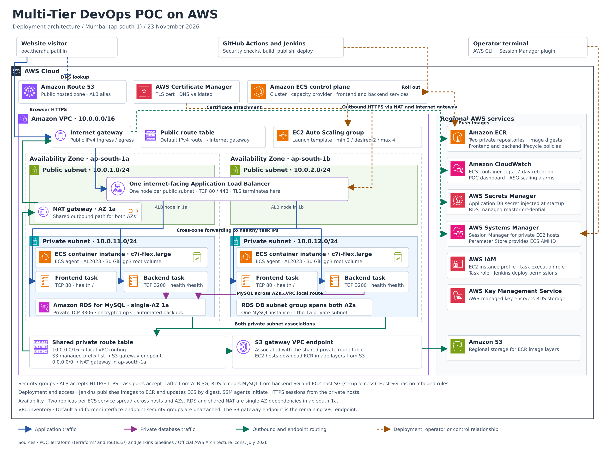

# Multi-Tier DevOps POC — AWS report

24 November 2026 · Mumbai (ap-south-1)

## 1. Objectives and application

The POC demonstrates a repeatable deployment of a three-tier web application on AWS. It validates infrastructure as code, security checks, deployment by immutable image digest, traffic distribution across two Availability Zones, private database access, observability, and the cost of running and pausing the environment.

| Tier | Implementation | Runtime responsibility |
| --- | --- | --- |
| Frontend | React and Vite, built with Node.js and served by non-root Nginx | Serves static files on TCP 80. The deployed build embeds `VITE_API_URL=/api` so browser API requests use the website hostname. |
| Backend | Node.js 22 and Express, running as the non-root node user | Serves the books and authors API on TCP 3200 and uses a MySQL connection pool. |
| Data | Amazon RDS for MySQL 8.4.11 | Stores application data on an encrypted 20 GiB gp3 volume. The single DB instance runs in ap-south-1a. |

## 2. AWS architecture

The layout represents the running POC configuration. The diagram uses the [AWS Architecture Icons](https://aws.amazon.com/architecture/icons/) package.

1. **Public entry point.** Route 53 resolves `poc.therahulpatil.in` through an alias in the existing public hosted zone. ACM supplies the DNS-validated certificate. One internet-facing ALB has a node in each public subnet. Its HTTP and HTTPS listeners forward the default path to the frontend IP target group on TCP 80 and `/api/*` to the backend IP target group on TCP 3200. The frontend target check uses `/`. The backend target check uses `/health` on the task, while the public `/api/books` smoke test exercises the API and its database path.
2. **Private workloads.** The VPC CIDR is `10.0.0.0/16`. Public subnets in 1a and 1b use `10.0.1.0/24` and `10.0.2.0/24`. Private subnets use `10.0.11.0/24` and `10.0.12.0/24`. ECS runs on private EC2 hosts. Each task uses `awsvpc`, gets a private IP, and registers that IP with its target group. Cross-zone forwarding gives the ALB access to healthy tasks in either zone.
3. **Database path.** The backend task definition sets `DB_HOST` to the RDS endpoint hostname and injects the application password from Secrets Manager at startup. The backend uses TCP 3306 over the VPC local route, including from the 1b subnet. The database interface was observed at `10.0.11.129` on 24 November. Use the RDS hostname because that IP can change. The DB subnet group spans both zones. MySQL currently runs in one zone, with one day of automated backup retention. An AWS-managed KMS key protects RDS storage. Secrets Manager holds the application DB secret and the RDS-managed master credential separately.
4. **Outbound access.** A single public NAT gateway and its Elastic IP in 1a serve both private subnets. ECS control-plane calls, ECR API and registry calls, CloudWatch Logs, Secrets Manager and Systems Manager use outbound HTTPS to public AWS endpoints. ECR image layers served by regional S3 follow the S3 gateway endpoint route. The other POC interface endpoints were removed. The ALB has two AWS-managed public IPv4 addresses, one per zone.
5. **Operations.** CloudWatch provides the POC dashboard, ECS log groups with seven-day retention, and ASG scaling alarms. AWS Systems Manager provides terminal access to private hosts through outbound agent connections. Systems Manager Parameter Store also supplies the recommended ECS-optimized AL2023 AMI to Terraform. There is no public SSH listener for the hosts.

| Route table | Destination | Target and purpose |
| --- | --- | --- |
| Public | `10.0.0.0/16` | Local VPC traffic |
| Public | `0.0.0.0/0` | Internet gateway for public IPv4 connectivity |
| Shared private | `10.0.0.0/16` | Local VPC traffic such as ALB to ECS and backend to RDS |
| Shared private | Regional S3 prefix list | S3 gateway endpoint for image layers |
| Shared private | `0.0.0.0/0` | NAT gateway in 1a for other outbound IPv4 traffic |

### Security groups and IAM

| Security group | Effective access and purpose |
| --- | --- |
| ALB | Public IPv4 TCP 80 and 443 inbound. TCP 80 outbound to frontend SG and TCP 3200 outbound to backend SG. |
| Frontend tasks | TCP 80 inbound from ALB SG. HTTPS 443 outbound. |
| Backend tasks | TCP 3200 inbound from ALB SG. MySQL 3306 outbound to RDS SG and HTTPS 443 outbound. |
| ECS EC2 hosts | Zero inbound. HTTPS outbound for AWS services and S3. Live setup access also allows MySQL 3306 to RDS. |
| RDS | MySQL 3306 inbound from backend SG and the ECS host SG for initial setup. Zero outbound rules. Security groups allow established return traffic. |
| Former interface endpoint and default groups | Both were observed unattached. The S3 gateway endpoint uses route tables. |

The **EC2 instance profile** lets the ECS agent register hosts and the SSM agent establish managed sessions. The **task execution role** grants ECS startup permissions for images, logs, and retrieval of the application DB secret. The **task role** is the application runtime identity. Jenkins uses a separate deployment credential with ECR, ECS and ASG permissions and scoped `iam:PassRole` for task registration. Reader and operator access should use an approved identity. Configuration and logs should omit secret values.

## 3. Build, scan and deploy

1. **Feature-branch feedback.** A push to a non-main branch runs `.github/workflows/branch-security.yml`. GitHub Actions runs temporary SonarQube, Trivy filesystem scanning and frontend/backend image scans, publishes reports, and evaluates the aggregate security gate. PR-opening events and main pushes do not trigger this workflow.
2. **Jenkins CI.** `Jenkinsfile.ci` checks out source, validates the workspace, runs SonarQube and builds frontend/backend Docker images with a commit-and-build-number tag. Trivy produces reports and the pipeline enforces the SonarQube and Trivy gates. The successful main CI path triggers `multi-tier-poc-cd` with the CI build number, image tag and both tested local image IDs. GitHub and Jenkins security gates are separate in the checked-in definitions. Removing duplicated Jenkins scanning would require a verified replacement gate for the deployment artifact.
3. **Jenkins CD.** `Jenkinsfile.cd` verifies upstream provenance and local image IDs, pushes the tested images to the two private ECR repositories and resolves the approved registry digests. It checks and protects the normal ASG baseline, then temporarily requests three hosts and waits for the spare to register. It deploys backend then frontend, copying each service's current task definition and replacing the application image with the approved digest. It waits for stabilization, checks the resulting task definition image, and archives `ecr-images.properties`. The post-build cleanup handles temporary capacity and restores the baseline when safe.
4. **How hosts and tasks converge.** The ASG normally runs two `c7i-flex.large` hosts across the private subnets and can reach four. Its launch template references the ECS-optimized AL2023 AMI and sets the cluster name at boot. The ECS agent registers the host. The capacity provider can request more eligible EC2 capacity. Each ECS service keeps two tasks, spreads placement by AZ and requires different EC2 hosts for its own replicas. One frontend and one backend task can share a host. Each host has a 30 GiB gp3 root volume under the observed configuration.
5. **Deployment availability.** The rolling configuration uses 100% minimum healthy and 200% maximum, so ECS can start replacement tasks and validate target health before removing the old tasks. At normal two-host capacity, the distinct-host constraint makes spare capacity important. ECS can roll back a failed rollout through its circuit breaker. The walkthrough verifies the active revision, healthy targets and deployed digests and covers common failures.

## 4. Cost and availability review

| Cost measure | USD | Basis |
| --- | --- | --- |
| POC-matching usage | $91.01 | 1–20 Nov 2026 UTC, pre-credit. Account billing meters matched to POC resources. Shared usage may be included. |
| Latest AWS account usage | $99.73 | 1–23 Nov 2026 UTC, pre-credit and estimated. Account-wide Cost Explorer usage, not a resource-attributed POC total. |
| Latest AWS account credits and net | $99.73 credits / $0.00 net | Same latest UTC window, rounded to cents. |
| Estimated running fixed cost | $0.30235/hr / $220.71 per 730-hour month | Mumbai model from the cost report before credits, taxes and variable usage. |
| Estimated paused fixed cost | About $0.10777/hr / $78.67 per 730-hour month | Running model less two EC2 hosts and RDS compute while they are stopped. |
| Estimated compute savings while paused | $0.19458/hr / $142.04 per 730 hours | Two EC2 hosts at $0.08479/hr each and RDS compute at $0.025/hr. Actual savings depend on stopped hours. |

Running monthly components are EC2 compute $123.79, EC2 EBS $5.47, RDS compute $18.25, RDS storage $2.62, NAT $40.88, ALB $17.45, three public IPv4 addresses $10.95, Secrets Manager $0.80 and the shared Route 53 zone $0.50. The cost report details historical interface endpoint charges, previous MySQL Extended Support charges, and usage-dependent NAT bytes, cross-AZ traffic, ALB capacity, ECR storage, logs, API calls and backups. Pausing retains VPC infrastructure and data, so storage and shared infrastructure charges continue. Plan for RDS to restart automatically after its AWS stop limit.

The ALB and ECS compute span two zones. A host failure can leave one healthy replica of each service while the ASG and ECS recover. RDS and NAT both depend on 1a. A 1a outage can interrupt database-backed requests and prevent tasks or hosts in 1b from reaching public service endpoints. Cross-AZ paths can also incur transfer charges.

### Open items and verification

- **Security cleanup.** Pending local Terraform edits remove temporary host-to-RDS access and make the dedicated host-to-S3 rule conditional. Backend task MySQL access and the S3 gateway endpoint are required. Review a fresh plan with the live variable inputs and independently review the existing ECR lifecycle edit before any apply.
- **Routing cleanup.** Confirm association, route and state ownership for any suspected extra route table before proposing its removal. The shared private route table must preserve local, S3 and NAT routing.
- **Cost follow-up.** Separate POC usage from shared or untagged account charges when attribution becomes available. Compare NAT and endpoint costs over a representative traffic window before deciding on another egress change.
- **Walkthrough readiness.** The current pause/resume scripts are local files under `Hault/`. A reviewer with only a fresh checkout needs the approved copies of the start, stop and shared scripts.
- **24 Nov verification.** AWS showed two running tasks out of two desired for each service, frontend revision 19 and backend revision 20, available single-AZ MySQL 8.4.11, one in-service EC2 host per AZ, two healthy ALB targets per service, and one available S3 gateway endpoint. The public website and books API both returned HTTP 200. The documentation work made no infrastructure changes.

Detailed commands are in [POC-Walkthrough.md](POC-Walkthrough.md). Per-resource billing is in [the existing cost report](POC-AWS-Cost-Report-2026-11-21.md).
